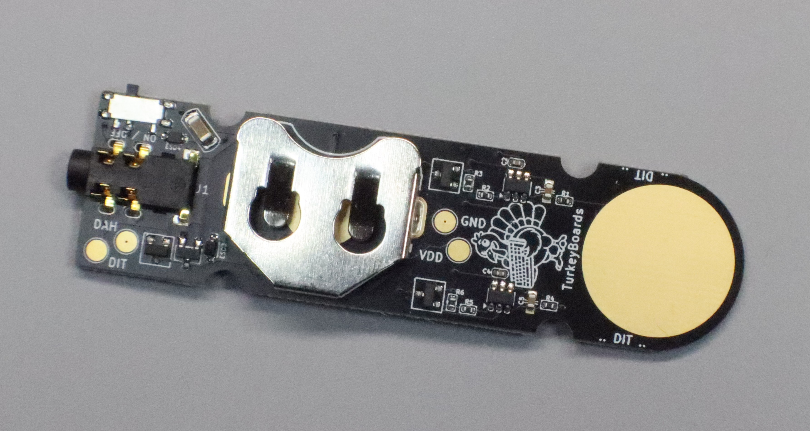
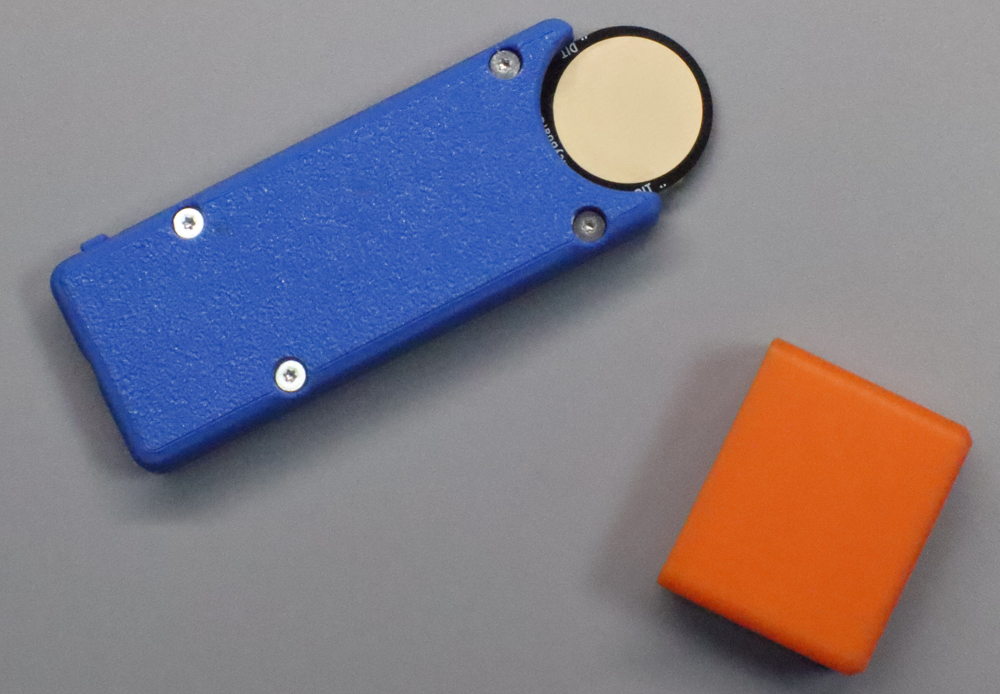
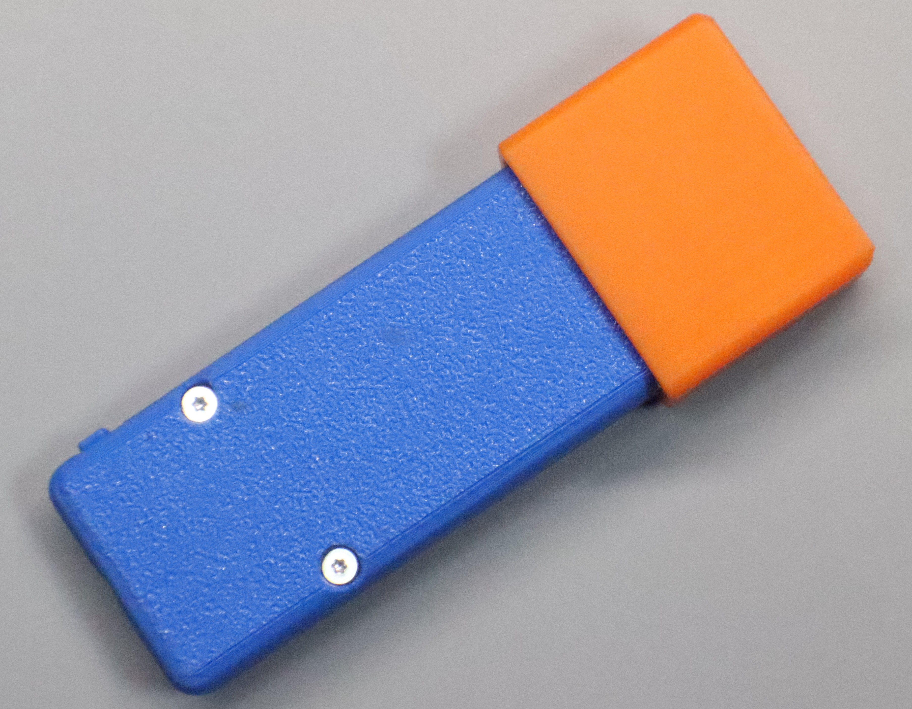
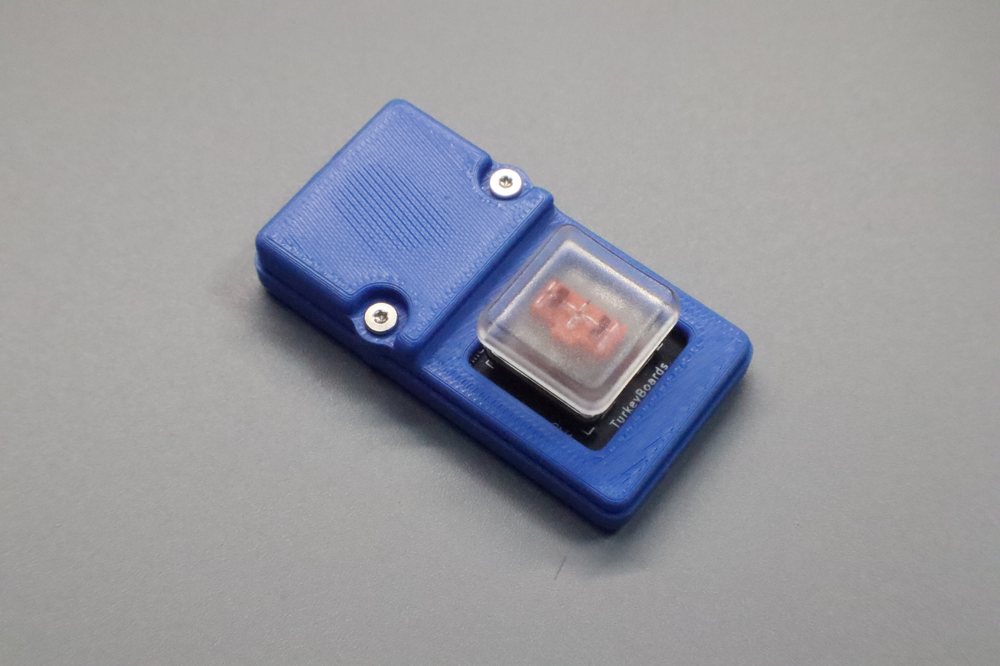
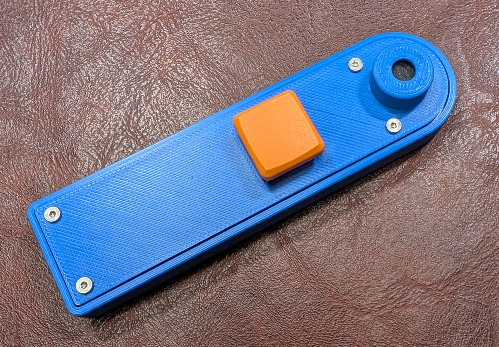
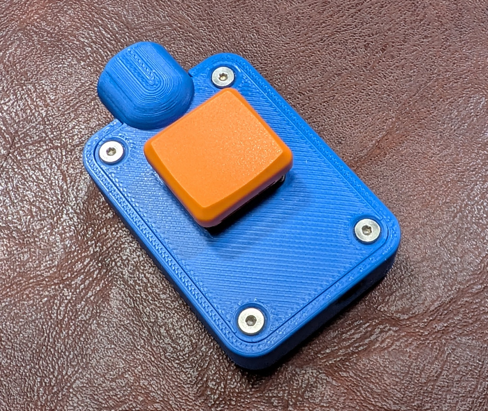

# Chickadee Portable Radio Accessories

The **Chickadee** family is a collection of small, durable amateur-radio accessories designed around portability, simplicity, repairability, and field use.

The family currently includes:

* **Chickadee Touch** — capacitive-touch iambic Morse paddle
* **Chickadee Tap** — single-button straight Morse key
* **Chickadee Double Tap** — mechanical iambic Morse paddle
* **Chickadee Chirp** — ultra-portable PTT microphone
* **Chickadee Chirp Mini** — extra-small ultra-portable PTT microphone

The Morse-key projects use standard 3.5 mm TRS key/paddle connections. The Chirp microphone projects use a 3.5 mm microphone/PTT connection with selectable wiring for compatibility with multiple portable radios.

---

# Credits & Inspiration

Several Chickadee projects were inspired by excellent work shared openly with the amateur-radio community.

## M0UKD — Capacitive CW Touch Key

The **Chickadee Touch** is based on and inspired by the capacitive CW touch-key work of **M0UKD**.

Original project:

https://m0ukd.com/homebrew/capacitive-cw-touch-key-circuits/

M0UKD's work provided the foundation for the capacitive sensing and solid-state CW keying approach used in the Chickadee Touch.

The Chickadee implementation adapts that concept into the TurkeyBoards portable form factor with its own PCB layout, power arrangement, protection circuitry, enclosure, and production-oriented design.

Many thanks to **M0UKD** for documenting and sharing the original design with the amateur-radio community.

## Adam, K6ARK — Mini Mic

The **Chickadee Chirp** and **Chickadee Chirp Mini** are based on and inspired by the excellent **K6ARK Mini Mic** project by Adam, K6ARK.

Original project:

https://k6ark.com/mini-mic-build-instructions/

K6ARK's design demonstrated an extremely compact and practical microphone/PTT solution for portable radios.

The Chickadee Chirp family builds on that concept with TurkeyBoards' own mechanical design and adds a **selectable microphone/PTT wiring arrangement**, allowing one microphone to work with multiple radio families that use different Tip/Ring assignments.

Many thanks to **Adam, K6ARK**, for publishing and sharing the original Mini Mic design and helping inspire these projects.

---

# Where to buy

TurkeyBoards offers assembled versions of the Chickadee projects.

**Chickadee Double Tap**

https://turkeyboards.com/products/chickadee-double-tap-iambic-morse-code-key

**Chickadee Tap**

https://turkeyboards.com/products/chickadee-tap

**Chickadee Touch**

https://turkeyboards.com/products/chickadee-touch-iambic-morse-code-key

**Chickadee Chirp**

https://turkeyboards.com/products/chickadee-chirp

**Chickadee Chirp Mini**

https://turkeyboards.com/products/chickadee-chirp-mini

---

## Quick comparison

| Project        | Input / Control Style                               | Intended Use                        | Power                           | Connection     |
| -------------- | --------------------------------------------------- | ----------------------------------- | ------------------------------- | -------------- |
| **Touch**      | Capacitive touch pads                               | Iambic CW paddle                    | CR2032 + optional radio-harvest | 3.5 mm TRS     |
| **Tap**        | Single mechanical keyboard switch                   | Straight CW key                     | None                            | 3.5 mm TRS     |
| **Double Tap** | Two mechanical keyboard switches                    | Iambic CW paddle                    | None                            | 3.5 mm TRS     |
| **Chirp**      | Keyboard-switch PTT + electret microphone           | Portable voice operation            | None                            | 3.5 mm mic/PTT |
| **Chirp Mini** | Miniature keyboard-switch PTT + electret microphone | Ultralight portable voice operation | None                            | 3.5 mm mic/PTT |

---

# Chickadee Touch

  
  
  

## What it is

The **Chickadee Touch** is a capacitive-touch iambic paddle implemented with two single-key capacitive-touch controllers and two MOSFET outputs that pull the radio's key lines to ground, much like a conventional paddle.

## Key features

* **Two touch pads:** DIT + DAH
* **3.5 mm TRS output:** Tip=DIT, Ring=DAH, Sleeve=GND
* **CR2032 coin-cell powered**
* **Optional radio-powered behavior** when the connected device provides pull-ups on the key lines
* **ESD protection** on the TRS lines
* **VDD clamp** for additional protection
* Compact and lightweight design intended for portable operation

## How it works

* Each touch pad is sensed by a capacitive-touch controller.
* When touched, the controller drives a MOSFET gate.
* The MOSFET pulls **TIP** for DIT or **RING** for DAH to **GND**.

## Power modes

* **ON:** the coin cell supplies a stable VDD rail.
* **OFF:** the battery is disconnected. If the key remains connected to some radios or keyers, however, the key lines may weakly back-power the internal circuitry through the protection/harvesting network unless full OFF isolation is incorporated.

### Known v1 behavior

Some radios and external keyers provide pull-ups on TIP and RING. With the current Touch architecture, leaving the unit **OFF but plugged in** can allow a small amount of current to enter the internal rail through the line-to-VDD circuitry. On certain radios this can result in unusual keyer behavior, including unintended alternating dits and dahs.

### Mitigations

* Leave the Chickadee Touch **ON while connected**.
* Unplug the key when switched OFF.
* A future revision can add true TIP/RING isolation or disable the harvesting path when switched OFF.

## Recommended parts

* Capacitive controller: **AT42QT1011** ×2
* Output MOSFET: **2N7002** ×2
* Pad network: 22k series resistance to SNSK
* Sense capacitor: approximately 2.2 nF between SNS and SNSK
* Local decoupling: 0.1 µF at each touch controller
* Bulk capacitance: approximately 47–100 µF on VDD
* ESD steering on TIP/RING
* VDD clamp to GND

## Layout notes

* Keep **SNS/SNSK routing short**.
* Keep touch-sense traces away from TIP/RING and the MOSFET drain traces.
* Avoid a **ground plane underneath the touch pads**.
* Use ground keepouts around sensitive SNS/SNSK routing.
* Place **ESD protection, VDD clamp, and bulk capacitance near the TRS connector**.
* Touch pads should use exposed copper with solder-mask opening and **no solder paste**.

## Buy the Chickadee Touch

https://turkeyboards.com/products/chickadee-touch-iambic-morse-code-key

---

# Chickadee Tap

  

## What it is

The **Chickadee Tap** is a single-button straight Morse key designed for maximum simplicity and portability. It uses standard mechanical keyboard components, making it lightweight, durable, inexpensive, and easy to repair.

## Wiring to TRS

For radios using a conventional key/paddle TRS input:

* **Sleeve → GND**
* **Tip → Key**
* **Ring → Not connected**

An optional jumper can be used where compatibility with non-standard equipment is desired.

Button wiring:

* One switch contact → **Tip**
* Other switch contact → **Sleeve / GND**

## Power

None required.

The Chickadee Tap is a completely passive switch closure to ground.

## Buy the Chickadee Tap

https://turkeyboards.com/products/chickadee-tap

---

# Chickadee Double Tap

  
  

## What it is

The **Chickadee Double Tap** is a compact iambic Morse paddle using standard mechanical keyboard switches. The design combines very low weight with durable and easily replaceable switching components.

## Wiring to TRS

* **Sleeve → GND**
* **Tip → DIT or DAH**
* **Ring → DAH or DIT**

A built-in selector switch allows the Tip and Ring assignments to be reversed without rewiring the key. This makes it easy to accommodate operator preference or radio configurations where paddle orientation differs.

## Power

None required.

The Chickadee Double Tap is completely passive and simply closes the selected key line to ground.

## Buy the Chickadee Double Tap

https://turkeyboards.com/products/chickadee-double-tap-iambic-morse-code-key

---

# Chickadee Chirp

  

## What it is

The **Chickadee Chirp** is an ultra-portable push-to-talk microphone designed for portable amateur-radio operation.

It uses a compact electret microphone and a mechanical keyboard-switch PTT in a lightweight, field-serviceable package.

A built-in selector switch allows the microphone and PTT connections to be swapped between two common portable-radio wiring arrangements, allowing one microphone to work with several different radios without carrying separate adapters or rewiring cables.

## Key features

* Compact electret microphone
* Mechanical keyboard-switch PTT
* Positive tactile PTT feel
* Selectable microphone/PTT wiring
* No internal battery
* No firmware
* No active controls
* Lightweight and field-serviceable design

## Compatible radios

The Chickadee Chirp is designed for radios using the supported 3.5 mm electret microphone/PTT wiring arrangements, including:

* **QRP Labs QMX**
* **QRP Labs QMX+**
* **(tr)uSDX**
* **uSDX and compatible variants**
* **BG2FX FX-4CR**
* **Elecraft KX2**
* **Elecraft KX3**

Other radios using the same microphone/PTT arrangements may also be compatible. Always verify the radio's microphone connector pinout before connecting equipment that has not already been tested.

## Why the selector switch matters

Portable radios do not all use the same Tip/Ring assignment for microphone audio and PTT. The Chickadee Chirp includes a selector that swaps those functions, allowing the same microphone to support both common arrangements.

Instead of carrying:

* two microphones,
* custom cables,
* or separate adapters,

the operator can simply change the selector position.

## Intended use

The Chickadee Chirp is especially well suited for:

* POTA
* SOTA
* QRP operation
* portable HF operation
* field communications
* emergency go kits
* travel
* compact shack installations

## Power

No internal battery is required.

The electret microphone receives its required bias from the connected radio, while the mechanical PTT switch provides the appropriate transmit-control connection.

## Buy the Chickadee Chirp

https://turkeyboards.com/products/chickadee-chirp

---

# Chickadee Chirp Mini

  

## What it is

The **Chickadee Chirp Mini** is the smallest version of the Chickadee portable microphone.

It carries the same basic functionality as the full-size Chirp in an even smaller TurkeyBoards form factor while retaining the selectable microphone/PTT wiring.

It is intended for operators who want to carry the smallest and lightest microphone practical.

## Key features

* Extremely compact design
* Electret microphone
* Mechanical keyboard-switch PTT
* Selectable microphone/PTT wiring
* No battery
* No firmware
* Lightweight and durable
* Easily repairable using standard keyboard-switch components

## Compatible radios

The Chickadee Chirp Mini supports the same radio families as the full-size Chirp, including:

* **QRP Labs QMX**
* **QRP Labs QMX+**
* **(tr)uSDX**
* **uSDX and compatible variants**
* **BG2FX FX-4CR**
* **Elecraft KX2**
* **Elecraft KX3**

Other radios using one of the same supported 3.5 mm microphone/PTT arrangements may also work.

## Chirp vs. Chirp Mini

Both models provide the same fundamental functionality.

Choose the **Chirp** if you prefer:

* slightly more physical size
* easier handling
* a more conventional handheld feel

Choose the **Chirp Mini** if your priorities are:

* minimum size
* minimum weight
* ultralight POTA or SOTA kits
* backpacking
* compact emergency kits
* extremely small travel setups

## Power

No internal battery is required.

The microphone element is powered by the connected radio.

## Buy the Chickadee Chirp Mini

https://turkeyboards.com/products/chickadee-chirp-mini

---

# Morse key TRS convention

The default Chickadee Morse-key convention is:

> **Tip = DIT**
> **Ring = DAH**
> **Sleeve = GND**

For the Chickadee Tap, Tip is normally used as the straight-key line while Ring remains unused.

---

# Compatibility notes

## Morse keys

Most modern radios and external keyers:

* internally pull the paddle/key inputs high,
* and detect a switch closure to ground.

Always verify the radio or keyer's connector and settings.

Some radios provide separate:

* **KEY**
* **PADDLE**

connections, while others use software/menu settings to determine whether the input is treated as a straight key or iambic paddle.

## Chirp microphones

Microphone/PTT connector wiring is less standardized than CW paddle wiring.

Before connecting an untested radio:

* verify that it uses a compatible electret microphone,
* verify the Tip/Ring/Sleeve assignment,
* verify the microphone-bias arrangement,
* and verify that PTT is activated using the expected contact closure.

The Chirp selector accommodates the two wiring arrangements used by the supported radio families but should not be assumed to make every 3.5 mm microphone jack compatible.

---

# Design philosophy

The Chickadee family is built around a few common goals:

* **Portable**
* **Lightweight**
* **Durable**
* **Simple**
* **Repairable**
* **Inexpensive to manufacture**
* **Compatible with commonly available parts**

Mechanical Chickadee products make extensive use of standard keyboard switches because they are inexpensive, readily available, provide excellent tactile feedback, have long service lives, and are easy to replace.

The goal is to create radio accessories that are easy to throw into a field kit without adding unnecessary weight, complexity, or proprietary components.